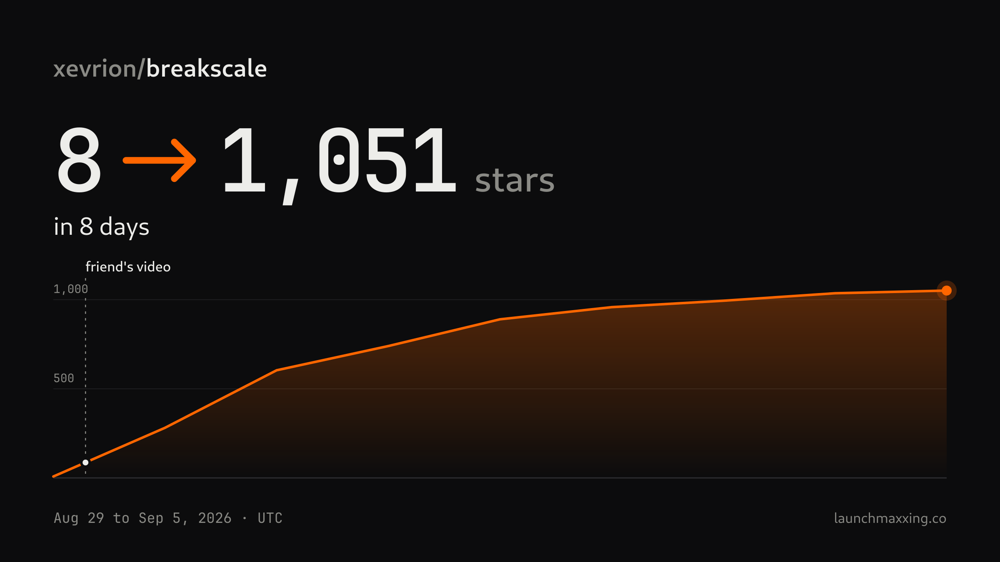

# lite

**Find the lines in your launch post that read like AI wrote them, and fix them in your own voice before anyone replies "slop".**

lite is a free Claude Code plugin with two commands. `/lm-lite:check` runs a real linter and a skeptical critic on any draft. `/lm-lite:card` turns your repo's star history into an image you can post. It never posts anything for you.



| 8 to 1,051 stars in 8 days | 195,162 vs 54,783 views | 47,891 views, 2 to 290 stars |
|---|---|---|
| breakscale, Aug 29 to Sep 5, 2026 (UTC). The card above is `/lm-lite:card` on its stargazer list. | breakscale on X: a friend's own video of the app vs my launch post. Read 2026-10-09. | gyotaku's launch post on X. Stars over the next 4 days. |

Those are my launches (I'm Yash Bavadiya). lite is the checking part of how I write launch posts now.

## Before and after

A made-up launch post for a made-up CLI, written as badly as I could. Then `/lm-lite:check` on it, for real. The full run is in [examples/slop-post](examples/slop-post/check-output.md).

| | Before | After `/lm-lite:check` |
|---|---|---|
| L1 | `🚀 Excited to announce envcheck - the game-changer every developer needs! 🔥` | Nobody wants to ship with a missing env var, so I built a CLI for it: envcheck. |
| L3 | `In today's fast-paced world, shipping with a missing env var is a journey nobody wants. That's why I built a seamless, robust, cutting-edge CLI that empowers you to unlock bulletproof deploys effortlessly.` | (cut) |
| L5 | `It reads every process.env in your code and compares it to .env.example -- so you find the missing ones before prod does.` | It reads every process.env in your code and compares it to .env.example, so you find the missing ones before prod does. |
| L7 | `It's not just a linter. It's a paradigm shift.` | It's a linter for your env vars. |
| L9 | `Let that sink in. 👇` | [needs a real demo: clip or screenshot of envcheck catching a missing var, plus the repo link] |
| L11 | `Like and RT if a missing .env has ever ruined your Friday!!! ✨` | Has a missing .env ever ruined your Friday? |
| slop-lint | 21 hits | clean |
| critic | REVISE, 2/10 | REVISE, 6/10 |

The after still says REVISE. The critic wants the closing question gone and won't pass a post that has no demo, and lite doesn't make one up. A second run cut the question ([after-round2.md](examples/slop-post/after-round2.md)). The demo is yours to record.

What slop-lint printed for the before, unedited:

```
examples/slop-post/before.md  exclamations   4 exclamation marks, keep it to 2 or fewer
examples/slop-post/before.md:1:1  phrase         "🚀" (🚀)
examples/slop-post/before.md:1:4  phrase         "Excited to announce" (excited to announce)
examples/slop-post/before.md:1:32  spaced-hyphen  "-" used as a dash
examples/slop-post/before.md:1:39  phrase         "game-changer" (game-changer)
examples/slop-post/before.md:1:75  phrase         "🔥" (🔥)
examples/slop-post/before.md:3:1  phrase         "In today's fast-paced" (in today's fast-paced)
examples/slop-post/before.md:3:12  phrase         "fast-paced world" (fast-paced world)
examples/slop-post/before.md:3:67  phrase         "journey" (journey)
examples/slop-post/before.md:3:110  phrase         "seamless" (seamless)
examples/slop-post/before.md:3:120  phrase         "robust" (robust)
examples/slop-post/before.md:3:128  phrase         "cutting-edge" (cutting-edge)
examples/slop-post/before.md:3:150  phrase         "empowers" (empowers)
examples/slop-post/before.md:3:166  phrase         "unlock" (unlock)
examples/slop-post/before.md:3:193  phrase         "effortlessly" (effortlessly)
examples/slop-post/before.md:5:72  spaced-hyphen  "--" used as a dash
examples/slop-post/before.md:7:6  phrase         "not just a" (not just a)
examples/slop-post/before.md:7:32  phrase         "paradigm shift" (paradigm shift)
examples/slop-post/before.md:9:1  phrase         "Let that sink in" (let that sink in)
examples/slop-post/before.md:9:19  phrase         "👇" (👇)
examples/slop-post/before.md:11:62  phrase         "✨" (✨)

21 hits in 1 file(s)
```

And for the after: `clean: 1 file(s)`.

## Install

Paste this to Claude Code:

> Install the lm-lite plugin from https://github.com/launchmaxxing/lite and run /lm-lite:check on my launch post.

Or run the two commands yourself:

```
/plugin marketplace add launchmaxxing/lite
/plugin install lm-lite@launchmaxxing-lite
```

Needs Node 18 or newer. The card also needs the GitHub CLI (`gh`), logged in.

## Use

**Check a draft.** Give it a file or paste the text:

```
/lm-lite:check drafts/launch-post.md
```

You don't have to type the command. Asking "is this tweet cringe?", "check my Show HN" or "does this sound like AI?" with a draft starts it too. You get a verdict, a 1 to 10 score, the weakest line, and a rewrite of each bad line that keeps your casing and slang. It never adds a number or a feature you didn't write; where a line needs one, it says `[needs a real number: ...]`. Pasted drafts and fixed copies are saved in `.launchmaxxing-lite/drafts/`. Your own files are never overwritten.

Two checks run, and they catch different things:
- **slop-lint**, a script. It flags the phrases from [data/slop-phrases.txt](data/slop-phrases.txt), em and en dashes, hyphens used as dashes, sentences over 30 words, more than 2 exclamation marks and emoji walls. Same input, same output, every time.
- **cringe-critic**, a subagent ([agents/cringe-critic.md](agents/cringe-critic.md)). It reads like a senior developer scrolling X with a thumb on mute. It catches what a word list can't: vague claims, engagement bait, talking about yourself first, a colon before a reveal.

**Make a star card.**

```
/lm-lite:card your-name/your-repo
```

Tell it when you posted and it adds markers. It writes a 1200x675 PNG and SVG to `.launchmaxxing/receipts/`. The card has a small "launchmaxxing.co" in the corner. To remove it, add `--no-mark`; nothing else changes. GitHub only shows star dates to a repo's owner, so run it on your own repo.

**Without Claude.** Both are plain Node scripts with no dependencies, the same scripts the paid kit uses:

```
node scripts/slop-lint.mjs my-post.md
node scripts/star-curve.mjs your-name/your-repo --since 2026-08-29 --card --png
```

`node scripts/slop-lint.mjs --help` lists every rule and option. It exits 1 on any hit, so it works in CI too.

## Examples

- [examples/slop-post](examples/slop-post/check-output.md): the before and after above, both runs, with the critic's full reports.
- [examples/readme](examples/readme/check-output.md): lite run on this README.
- [evals/evals.json](evals/evals.json): test cases for both commands. `node evals/check.mjs --help` scores a run against them.

## What lite doesn't do

- Post, schedule, DM or submit anything. You do every outward step.
- Write your launch post from nothing. It checks and fixes what you wrote.
- Know the rules of the place you're posting to.
- Get you past AI detectors. The goal is a post people read to the end.

## The paid kit

lite is the free part of [Launchmaxxing](https://launchmaxxing.co), a paid Claude Code kit. It adds rules for 132 places to launch, each checked from that place's rules page, and the drafting and follow-up workflows I use.

## License

MIT. See [LICENSE](LICENSE).
